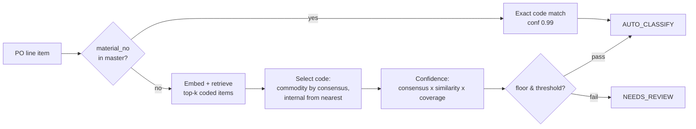

# Spending Analysis — RAG-based UNSPSC spend classification


Classify every purchase-order line into a UNSPSC commodity code, automatically,
with a confidence score that decides whether a human needs to look. The system is
**retrieval-augmented**: it grounds each decision on the most similar items that
have already been coded under contract, then either copies a code (high
confidence) or routes the line to a buyer (low confidence or off-catalogue).

> **Built from scratch on 100% synthetic data.** This is a clean-room
> reimplementation of a system I built and ran in production. It contains **no
> proprietary code and no company data** — the taxonomy, the contract corpus, and
> the purchase-order items are all generated by `scripts/generate_synthetic_data.py`,
> and the UNSPSC codes here are synthetic (they reproduce the *structure* of the
> real standard, not its contents). It runs end to end with no API key.

## The problem

Procurement spend is only as analysable as its coding. If half the purchase
orders aren't mapped to a consistent taxonomy, you can't answer "how much did we
spend on valves last year" or "which categories are under contract". Coding lines
by hand is slow and inconsistent; a flat supervised classifier struggles because
the label space is enormous and sparse and the catalogue keeps changing.

The lever that makes this tractable is that **most spend flows through contracts**
— roughly 78% in this dataset. Items bought under contract already carry an
authoritative code, which makes them an ideal retrieval corpus: a new line can be
classified by finding the contract items most like it and reusing their code.
Adding a contract becomes a data change, not a model retrain, and every decision
is explainable by the neighbours that grounded it.

This repository implements that idea: a two-step classifier (exact-code match →
semantic retrieval) with confidence-gated human-in-the-loop, an honest evaluation
harness, a threshold sweep, a CLI demo, and a small API.

## Architecture



Two pieces are swappable behind one interface each, so the same pipeline runs
offline or in production: retrieval is **hashed TF-IDF** offline or **OpenAI
embeddings** in production; code selection is a **similarity-weighted vote**
offline or a **grounded LLM** in production. Full write-up in
[`docs/architecture.md`](docs/architecture.md).

## Quickstart

```bash
pip install -e ".[dev]"

make data     # regenerate the synthetic taxonomy, corpus, and PO items
make demo     # classify representative items, with retrieved candidates
make eval     # accuracy + automation-safety metrics -> eval/results.json
make sweep    # threshold trade-off curve            -> eval/sweep.json
make test     # 27 tests
make api      # FastAPI on :8000  (GET /health, POST /classify)
```

Everything runs **offline and deterministically** by default (hashed TF-IDF +
weighted-vote selector, seed `7`). No API key is needed for the demo, the eval, or
the tests. To use real backends instead:

```bash
export OPENAI_API_KEY=sk-...
export SPEND_EMBEDDING_BACKEND=openai     # dense embeddings for retrieval
export SPEND_CLASSIFIER_BACKEND=openai    # LLM picks the code, grounded on neighbours
```

The committed `data/` corpus and `eval/results.json` / `eval/sweep.json` let you
read the numbers straight from the repo without running anything.

## Results

Measured on 185 synthetic PO items (144 under contract = 78%) against a 148-item
coded corpus spanning 7 segments / 37 commodities. Default confidence threshold
`0.70`. Reproduce with `make eval`.

**Classification accuracy** (over contract items, by taxonomy level):

| level | accuracy |
|---|---|
| family (4-digit) | 99.3% |
| class (6-digit) | 99.3% |
| **commodity (8-digit)** | **92.4%** |
| full 12-digit (incl. internal extension) | 75.7% |
| top-k retrieval hit (truth commodity retrieved) | 99.3% |
| commodity accuracy among auto-classified | 96.0% |

The honest story is in the gap between the last two structural rows. **Commodity
accuracy is 92.4%**; the truth commodity is in the retrieved set 99.3% of the
time, so almost all remaining commodity errors are *selection* errors on
genuinely ambiguous lines (a paraphrase that dropped its distinctive head word —
"… valve 150 lb ss" with no "gate"/"ball"/"globe"). **Full 12-digit accuracy is
only 75.7%**, and that is expected: the 4-digit internal extension is a
company-specific sub-code that often *cannot* be recovered from a description
alone, so it is inherited from the nearest neighbour as a best effort. The system
is confident about the commodity and explicit about the rest.

**Automation safety** (treating it as a decision system):

| metric | value |
|---|---|
| auto-classify rate | 67.6% |
| auto-classify precision | 96.0% |
| review recall (of items that should be reviewed) | 90.4% |

|  | auto-classified | review |
|---|---|---|
| correct / shouldn't-review | 120 | 13 |
| **wrong / should-review** | **5** | 47 |

So ~68% of lines are coded with no human touch at 96% precision, while 90% of the
lines that *needed* a human (wrong code or off-catalogue spend) were caught. p50
latency is ~0.24 ms/item with the offline backend.

### The confidence dial actually works here

`make sweep` moves the auto-classify threshold and writes `eval/sweep.json`:

| threshold | auto rate | auto precision | review recall | incorrect auto |
|---|---|---|---|---|
| 0.55 | 78.4% | 91.7% | 76.9% | 12 |
| 0.65 | 75.7% | 95.0% | 86.5% | 7 |
| **0.70** | **67.6%** | **96.0%** | **90.4%** | **5** |
| 0.75 | 65.4% | 99.2% | 98.1% | 1 |
| 0.80 | 54.6% | 100.0% | 0 incorrect | 0 |

This is a clean, monotonic precision/automation trade-off — you dial in the
operating point your downstream tolerance allows. It's a deliberate contrast with
my other repo, [Flip to PO](https://github.com/thimabhornK), where the same sweep
is almost *flat*: there, the residual errors were high-confidence-but-wrong
(a field with no cross-check), so confidence couldn't separate them. Here the
residual errors are ambiguous-retrieval cases that genuinely carry lower
confidence, so the threshold separates them well. Same gating machinery, two
different error structures — worth understanding the difference.

## Design decisions

- **Two-step: exact match before semantics.** Items bought before carry an
  authoritative code; copying it (confidence 0.99) is free precision and
  short-circuits a large share of lines. Retrieval is only for the rest.
- **Commodity by consensus, internal by nearest neighbour.** Retrieval reliably
  determines *what kind of thing* an item is, not a company-internal sub-code.
  Voting at the commodity level keeps the signal from being diluted by the
  several internal variants a commodity has in the corpus; the internal extension
  is a transparent best-effort inherit. The evaluation scores both so the
  limitation is visible, not hidden.
- **Confidence = consensus × similarity × coverage.** A code is auto-applied only
  when the neighbours agree *and* the closest one is genuinely close *and* the
  item is inside the catalogue. The coverage factor stops off-catalogue spend from
  scoring high just because its (equally weak) neighbours happen to agree.
- **Human-in-the-loop by default.** The output is an input to a buyer's decision,
  not the final word. Low-confidence and off-catalogue lines route to review; the
  threshold sets how aggressive automation is.
- **Two backends behind one interface.** The offline TF-IDF + vote path makes the
  whole system testable and reproducible in CI; the OpenAI embeddings + LLM path
  shows the production shape and the prompt engineering. Nothing else changes when
  you switch.

## What's mocked vs. production

| Concern | This repo (offline) | Production |
|---|---|---|
| Retrieval | hashed TF-IDF over tokens | dense embeddings + ANN index |
| Code selection | similarity-weighted vote | LLM grounded on retrieved candidates |
| Corpus | generated JSON | contract master from the ERP |
| Items to classify | labelled synthetic set | live PO lines |
| Output | JSON / API response | write-back + a human review queue |

A natural extension (and the real deliverable in production) is an Excel export of
the classified lines with their candidates and confidences for buyers to review;
that's a thin layer on top of `Classification.to_audit_dict()`.

## Repository layout

```
src/spend_classifier/
  pipeline.py            two-step orchestration (exact -> retrieval -> gate)
  confidence.py          consensus x similarity x coverage scoring
  taxonomy.py            8-digit standard + 4-digit internal = 12-digit code
  schemas.py             typed PO item / master item / classification
  retrieval/             TextVectorizer (TF-IDF | OpenAI) + cosine index
  classifier/            CodeSelector (weighted vote | grounded LLM) + prompts
  knowledge_base.py      load the coded-item corpus + taxonomy
  api/app.py             FastAPI: /health, /classify
scripts/
  generate_synthetic_data.py   taxonomy + corpus + labelled PO set (seed 7)
  demo.py                      CLI walkthrough of the decision paths
eval/
  harness.py             per-level accuracy + automation-safety metrics
  report.py / sweep.py   console tables; writes results.json / sweep.json
tests/                   27 tests across taxonomy, retrieval, selection, pipeline
data/                    generated taxonomy, corpus, and PO items (committed)
docs/architecture.md     diagram + stage-by-stage design notes
```

## Context

This is a clean-room version of a production system I built at SCG Chemicals that
classified **150,088 purchase-order items (~US$95M of spend)** into an internal
UNSPSC taxonomy at **~92% accuracy**, saving an estimated **1,104 work-hours/year**
of manual coding. That system extended the public 8-digit UNSPSC code to a
**12-digit internal taxonomy**, anchored on the **78% of spend under contract** as
its grounding corpus, and used **confidence scoring with human-in-the-loop** for
the rest — exactly the design reproduced here on synthetic data. The original code
and data are proprietary and are not included; this repository was written from
scratch to show the architecture and engineering.

## License

MIT — see [LICENSE](LICENSE).
