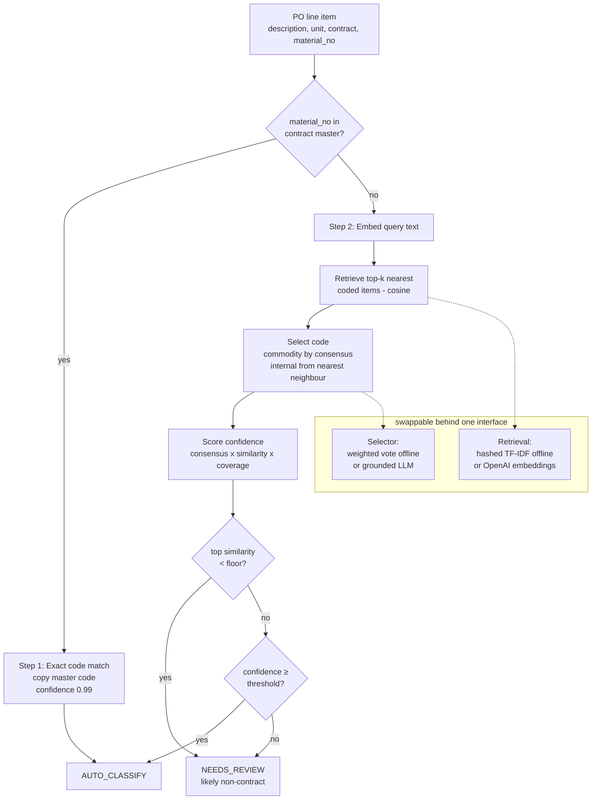

# Architecture

## Pipeline



## Why retrieval-augmented, not a flat classifier

A plain supervised classifier over UNSPSC codes has two problems in a real
procurement setting: there are thousands of codes (a huge, sparse label space),
and the catalogue changes — new contracts, new materials, retired codes. A RAG
approach sidesteps both. The "knowledge" lives in a corpus of already-coded
contract items; classifying a new item means *finding the most similar coded
items and reusing their code*. Adding a contract is a data change, not a model
retrain, and every decision is explainable by the neighbours it was grounded on.

## Stage by stage

**Step 1 — Exact code match.** If the item carries a material number that exists
in the contract master, its code is authoritative. This is copied directly with
confidence 0.99. In a real book this short-circuits a large share of lines
(the items that were bought before) at essentially zero risk.

**Step 2a — Retrieval.** The item's text (`description | unit | contract | type`)
is vectorised and compared against the corpus by cosine similarity; the top *k*
neighbours are returned with their codes and scores. Two vectorisers sit behind
one interface (`TextVectorizer`): an offline **hashed TF-IDF** (deterministic,
no network — what the tests and the committed eval use) and **OpenAI dense
embeddings** for production. Swapping is one environment variable.

**Step 2b — Code selection.** A `CodeSelector` turns the neighbours into a code.
The offline `MockCodeSelector` decides the **commodity** (8-digit) by a
similarity-weighted vote and inherits the **4-digit internal extension** from the
single closest neighbour. The `OpenAICodeSelector` instead asks an LLM to choose,
grounded on the same neighbours, and may propose a standard code that is *not* in
the corpus (`in_master = false`) for genuinely novel items — but never a
malformed code.

Why split commodity from internal? Retrieval reliably tells you *what kind of
thing* this is (the commodity); it cannot reliably recover a company-internal
sub-code from a paraphrased description. Voting at the commodity level keeps the
signal undiluted by the several internal variants a commodity has in the corpus,
and the internal code is filled in as a best-effort inherit. The evaluation
reports both, honestly: commodity accuracy is high; full 12-digit accuracy is
lower, and that gap *is* the internal-extension problem.

**Step 3 — Confidence and gating.** Confidence blends three factors:

```
confidence = coverage * ( w * consensus + (1 - w) * similarity_adequacy )
```

- **consensus** — share of the retrieved similarity mass that agrees on the
  chosen commodity (do the neighbours agree?).
- **similarity_adequacy** — the top similarity scaled by a reference (is the
  closest neighbour actually close?).
- **coverage** — collapses to 0 when even the nearest neighbour is below the
  similarity floor, so out-of-catalogue spend can't earn a high score by having
  equally-weak neighbours that happen to agree.

An item auto-classifies only if its top similarity clears the floor **and** its
confidence clears the threshold; otherwise it routes to a buyer. The threshold is
the single dial that trades automation rate against precision (see the sweep in
the README).

## What is mocked vs. what production looks like

| Concern | This repo (offline) | Production |
|---|---|---|
| Retrieval | hashed TF-IDF over tokens | dense embeddings (OpenAI / bge / e5) + ANN index |
| Code selection | similarity-weighted vote | LLM grounded on retrieved candidates |
| Corpus | generated JSON (`data/knowledge_base`) | contract master from the ERP |
| Items to classify | labelled synthetic set | live PO lines |
| Output | JSON / API response | write-back to the spend system + review queue |

The interfaces (`TextVectorizer`, `CodeSelector`) are identical across both, so
the offline path is a faithful stand-in for the real one — it just runs anywhere,
deterministically, with no credentials.
